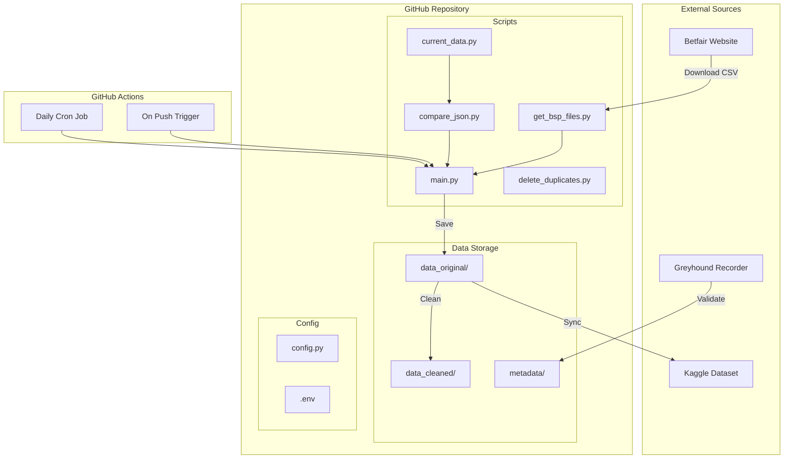

# Betfair SP Repository Improvement Plan

## Executive Summary

This plan outlines improvements to the betfair_sp repository for better automation, data management, and expansion to additional sports. The repository currently downloads Betfair Starting Price data for horse racing and greyhound racing, storing it for use in testing betting strategies with historic data.

---

## Current State Analysis

### Repository Structure

```
betfair_sp/
├── main.py                    # Main orchestrator script
├── get_bsp_files.py           # Fetches available files from Betfair website
├── current_data.py            # Creates JSON of current local files
├── compare_json.py            # Compares and finds missing files
├── delete_duplicates.py       # Cleans up duplicate/non-CSV files
├── organise.py                # Creates folder structure
├── requirements.txt           # Python dependencies
├── .github/workflows/
│   └── actions.yml            # GitHub Actions workflow (cron disabled)
└── data_original/
    ├── greyhound/YEAR/MONTH/  # Greyhound racing data
    └── horse/COUNTRY/YEAR/MONTH/  # Horse racing data by country
```

### Data Source
- **URL**: `https://promo.betfair.com/betfairsp/prices`
- **Format**: CSV files with columns: EVENT_ID, MENU_HINT, EVENT_NAME, EVENT_DT, SELECTION_ID, SELECTION_NAME, WIN_LOSE, BSP, PPWAP, MORNINGWAP, PPMAX, PPMIN, IPMAX, IPMIN, MORNINGTRADEDVOL, PPTRADEDVOL, IPTRADEDVOL
- **Countries supported**: aus, uk, rsa, usa, ire, fr, uae

### Current Issues Identified

1. **GitHub Actions cron job is disabled** - currently runs only on push
2. **Path inconsistencies** - scripts use both `./data_original` and `data_original/`
3. **README outdated** - contains Coming in 2024 references
4. **No data validation pipeline** - data quality issues not systematically handled
5. **No multi-sport support** - only horse racing and greyhound currently
6. **No data status reporting** - no visibility into data completeness

---

## Implementation Plan

### Phase 1: Foundation Improvements

#### 1.1 Fix Path Inconsistencies
**Files to modify:**
- `main.py` - line 60: standardize to `data_original/`
- `compare_json.py` - already uses `data_original/`
- `current_data.py` - line 43: standardize to `data_original/`
- `delete_duplicates.py` - line 27: uses `data/` but should be `data_original/`

**Action Items:**
- [ ] Create a central config module `config.py` with all path constants
- [ ] Update all scripts to import paths from config
- [ ] Add path validation at startup

#### 1.2 Fix GitHub Actions Workflow
**Current issues:**
- Cron schedule is commented out
- Uses deprecated `actions/checkout@v2`
- No error handling or notifications

**Improvements:**
- [ ] Update to `actions/checkout@v4`
- [ ] Re-enable cron schedule: `0 1 * * *` for daily at 1:00 AM UTC
- [ ] Add error notification via GitHub Actions
- [ ] Add workflow status badge to README
- [ ] Consider adding manual trigger option

**Updated workflow structure:**
```yaml
name: Daily BSP Data Sync

on:
  schedule:
    - cron: '0 1 * * *'
  push:
    branches: [main]
  workflow_dispatch:  # Manual trigger

jobs:
  sync-data:
    runs-on: ubuntu-latest
    steps:
      - uses: actions/checkout@v4
      - uses: actions/setup-python@v5
        with:
          python-version: '3.11'
      - name: Install dependencies
        run: pip install -r requirements.txt
      - name: Run data sync
        run: python main.py
      - name: Commit changes
        run: |
          git config user.email "action@github.com"
          git config user.name "GitHub Action"
          git add -A
          git diff --staged --quiet || git commit -m "chore: daily data sync $(date +%Y-%m-%d)"
          git push
```

---

### Phase 2: Data Management

#### 2.1 Data Status Reporting
Create a data status dashboard that tracks:
- Total files by sport and country
- Date range coverage
- Missing dates/gaps
- Last sync timestamp

**Implementation:**
- [ ] Create `data_status.py` module
- [ ] Generate `data_original/status_report.json` with metrics
- [ ] Generate `data_original/STATUS.md` human-readable summary
- [ ] Add status check to GitHub Actions

**Status Report Structure:**
```json
{
  "last_updated": "2024-12-31T01:00:00Z",
  "summary": {
    "total_files": 15234,
    "sports": ["greyhound", "horse"],
    "date_range": {"start": "2007-12-13", "end": "2024-12-30"}
  },
  "by_sport": {
    "greyhound": {
      "total_files": 8542,
      "date_range": {"start": "2014-01-03", "end": "2024-12-30"},
      "gaps": ["2014-02-15", "2014-03-22"]
    },
    "horse": {
      "by_country": {
        "uk": {"total_files": 2100, "date_range": {...}},
        "aus": {...}
      }
    }
  }
}
```

#### 2.2 Data Location Organization
**Current structure** - Already well-organized with:
- `data_original/greyhound/YEAR/MONTH/`
- `data_original/horse/COUNTRY/YEAR/MONTH/`

**Enhancements:**
- [ ] Add `data_original/metadata/` for JSON tracking files
- [ ] Add `data_cleaned/` parallel structure for cleaned data
- [ ] Update `.gitignore` to exclude temporary processing files
- [ ] Create `data_original/README.md` documenting the data structure

---

### Phase 3: Data Cleaning Pipeline

#### 3.1 Known Issues to Address

**Issue A: Extra columns in EVENT_NAME**
- Problem: Commas in EVENT_NAME string cause column misalignment
- Affected: Greyhound races 2017-2024, UK races with Trap Challenge

**Issue B: Missing MENU_HINT data**
- Problem: Australian greyhound races missing MENU_HINT details
- Currently fixed for 2017-2024

**Implementation:**
- [ ] Create `data_cleaning/` module directory
- [ ] Create `clean_csv.py` with validation functions
- [ ] Create `fix_event_name.py` for comma handling
- [ ] Create `validate_schema.py` for column validation
- [ ] Add cleaning step to GitHub Actions workflow

**Data Cleaning Pipeline:**
```
┌─────────────────┐
│ Raw CSV Download │
└────────┬────────┘
         │
         ▼
┌─────────────────┐
│ Schema Validation│ → Check column count, types
└────────┬────────┘
         │
         ▼
┌─────────────────┐
│ EVENT_NAME Fix  │ → Merge split columns
└────────┬────────┘
         │
         ▼
┌─────────────────┐
│ Missing Data    │ → Flag/fill MENU_HINT gaps
│ Detection       │
└────────┬────────┘
         │
         ▼
┌─────────────────┐
│ Save to         │
│ data_cleaned/   │
└─────────────────┘
```

#### 3.2 Validation Rules
- [ ] Column count must be 17
- [ ] EVENT_DT must be valid date format
- [ ] BSP must be numeric and > 0
- [ ] WIN_LOSE must be 0 or 1
- [ ] SELECTION_ID must be numeric

---

### Phase 4: Multi-Sport Expansion

#### 4.1 Research Required
The current data source only provides horse racing and greyhound data. For soccer, tennis, and cricket:

**Action Items:**
- [ ] Research Betfair Exchange API for other sports data
- [ ] Identify alternative data sources for BSP-equivalent data
- [ ] Document data format differences between sports
- [ ] Create sport-specific data models

**Proposed Directory Structure for Multi-Sport:**
```
data_original/
├── greyhound/YEAR/MONTH/
├── horse/COUNTRY/YEAR/MONTH/
├── soccer/LEAGUE/YEAR/MONTH/      # Future
├── tennis/TOUR/YEAR/MONTH/        # Future
└── cricket/COMPETITION/YEAR/MONTH/ # Future
```

#### 4.2 Modular Sport Handlers
- [ ] Create `sports/base_handler.py` abstract class
- [ ] Create `sports/greyhound.py` handler
- [ ] Create `sports/horse.py` handler
- [ ] Future: Add handlers for soccer, tennis, cricket

---

### Phase 5: Cross-Reference Validation

#### 5.1 External Data Sources
- **Greyhound**: thegreyhoundrecorder.com.au (already used for MENU_HINT)
- **Horse Racing**: To be researched
- **Other Sports**: To be researched

**Implementation:**
- [ ] Create `validation/` module
- [ ] Create `cross_reference.py` for result verification
- [ ] Add validation reports to status dashboard
- [ ] Flag discrepancies for manual review

---

### Phase 6: README and Documentation

#### 6.1 README Updates Required

**Remove/Update:**
- [ ] Remove Coming in 2024 header
- [ ] Remove all future date references
- [ ] Update contact section
- [ ] Remove Soccer/Tennis/Cricket as Coming 2024

**Add:**
- [ ] Current data status badge
- [ ] Workflow status badge
- [ ] Data structure documentation
- [ ] Contribution guidelines
- [ ] Usage examples for data analysis

**Proposed README Structure:**
```markdown
# Betfair Starting Price Data


## Overview
Historical Betfair Starting Price data for horse racing and greyhound racing.

## Available Data
- Greyhound Racing: 2014-present
- Horse Racing: 2007-present (UK, AUS, RSA, USA, IRE, FR, UAE)

## Data Download
Kaggle: https://www.kaggle.com/datasets/eonsky/betfair-sp

## Usage
[Examples of loading and analyzing the data]

## Data Quality
[Known issues and cleaning status]

## Current Goal
[Single current objective being worked on]

## Contributing
[How to contribute]
```

---

## Priority Order

### High Priority
1. Fix GitHub Actions workflow - re-enable cron, update actions versions
2. Fix path inconsistencies across all scripts
3. Update README - remove outdated references
4. Create data status reporting

### Medium Priority
5. Implement data cleaning pipeline
6. Create centralized configuration
7. Add workflow notifications

### Lower Priority
8. Multi-sport expansion research
9. Cross-reference validation system
10. Advanced reporting dashboard

---

## PRD Template Reference

For future feature planning, use this PRD template:

```markdown
# Product Requirements Document

## Document Information
- **Feature Name**: [Name]
- **Author**: [Name]
- **Created**: [Date]
- **Status**: Draft | In Review | Approved

## Problem Statement
[What problem are we solving?]

## Goals
- [Goal 1]
- [Goal 2]

## Non-Goals
- [What we are NOT trying to solve]

## User Stories
- As a [user type], I want [action] so that [benefit]

## Technical Requirements
### Functional Requirements
- [FR-1] Description
- [FR-2] Description

### Non-Functional Requirements
- [NFR-1] Performance: [requirement]
- [NFR-2] Security: [requirement]

## Design
### Architecture
[Diagrams and descriptions]

### Data Model
[Schema changes]

### API Changes
[Endpoint changes]

## Implementation Plan
### Phase 1
- [ ] Task 1
- [ ] Task 2

### Phase 2
- [ ] Task 3

## Metrics
- [How we measure success]

## Risks and Mitigations
| Risk | Impact | Mitigation |
|------|--------|------------|
| Risk 1 | High/Med/Low | Mitigation approach |

## Open Questions
- [ ] Question 1
- [ ] Question 2

## References
- [Link to related docs]
```

---

## Architecture Diagram



---

## Next Steps

1. Review this plan with the repository owner
2. Prioritize which phases to implement first
3. Create individual issues/tasks for each action item
4. Begin implementation with Phase 1 foundation improvements

---

## Appendix: File Changes Summary

| File | Changes Required |
|------|-----------------|
| main.py | Path standardization, add config import |
| get_bsp_files.py | Path standardization |
| current_data.py | Path standardization |
| compare_json.py | Already correct |
| delete_duplicates.py | Fix path from data/ to data_original/ |
| .github/workflows/actions.yml | Re-enable cron, update versions |
| README.md | Remove outdated content, add status |
| requirements.txt | Add pandas for data cleaning |
| NEW: config.py | Central configuration |
| NEW: data_status.py | Status reporting |
| NEW: data_cleaning/*.py | Cleaning pipeline |
